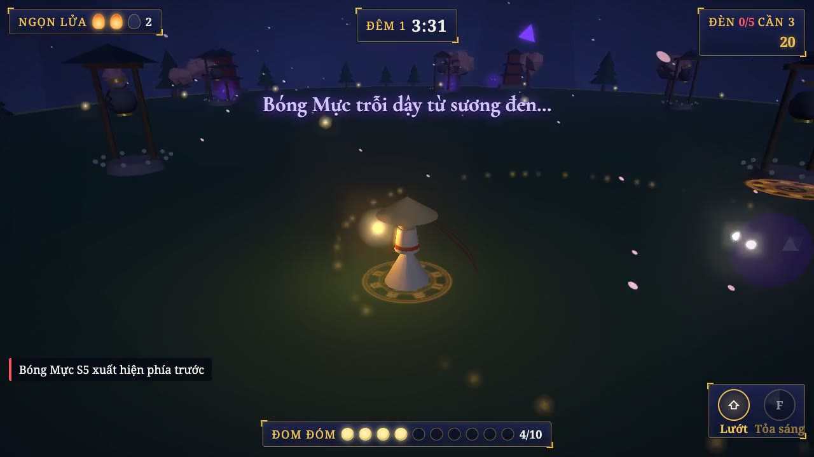
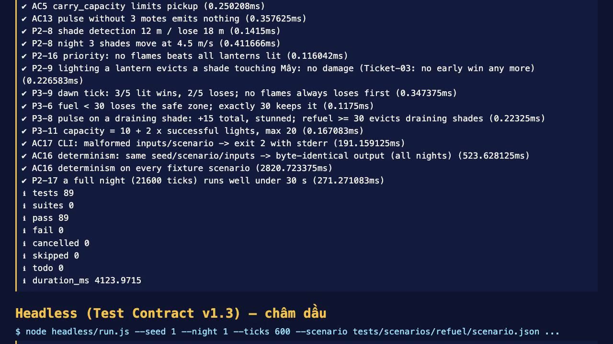
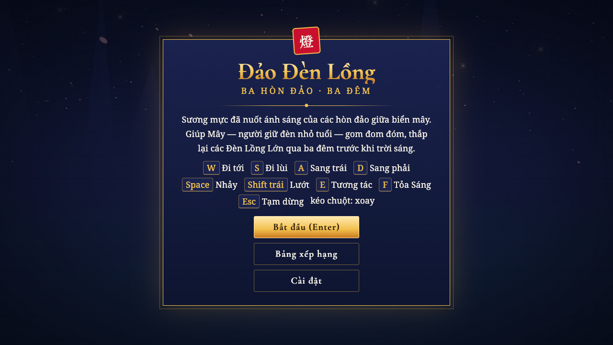

# Đảo Đèn Lồng — v1.0.0

> **🎬 Video demo (2 phút 50 giây):** [docs/demo/demo.mp4](docs/demo/demo.mp4). Bản này cũng được đính kèm ở Release `v1.0.0`.
> Day 12 · AI SDLC Lab · Nguyễn Huy Hoàng · 2A202603366 · Tài liệu lab gốc: [docs/lab/LAB-README.md](docs/lab/LAB-README.md)

Game 3D góc nhìn thứ ba. Mây, người giữ đèn nhỏ tuổi đội nón lá treo đèn lồng, đi qua **ba đêm trên ba hòn đảo** giữa biển mây. Mây gom đom đóm để thắp và **giữ cho các Đèn Lồng Lớn sáng tới bình minh**, vì đèn cạn dầu dần và Bóng Mực hút dầu. Mây phải né và xua **Bóng Mực** và **Gió Lạc**.

| Chơi | Cảnh benchmark (200 Bóng Mực) | Menu |
|---|---|---|
|  |  |  |

## Yêu cầu hệ thống

- macOS hoặc Linux (Windows chạy được nếu có Node), **Node.js ≥ 18**. **Không cần `npm install`**, không có dependency.
- Trình duyệt có WebGL2: Chrome/Edge, Firefox hoặc Safari bản mới. **Nên có GPU** (đo được khoảng 60 FPS ở 1280×720; chạy hoàn toàn bằng phần mềm chỉ khoảng 9 FPS).
- Benchmark cần Google Chrome hoặc Chromium (đường dẫn tùy chỉnh qua biến `CHROME=`).

## Cài đặt và chạy (3 lệnh)

```bash
git clone https://github.com/nguyen-huy-hoang-1708/K5-L3A-DAY12-NguyenHuyHoang-2A202603366-AI-SDLC-Dao-Den-Long.git
cd K5-L3A-DAY12-NguyenHuyHoang-2A202603366-AI-SDLC-Dao-Den-Long
node tools/serve.js
```

Trình duyệt tự mở http://localhost:8080/web/. Nếu không tự mở, bạn mở link đó bằng tay. Nếu dùng **Release v1.0.0**: giải nén `dao-den-long-v1.0.0-web.zip`, `cd` vào thư mục, rồi chạy `node tools/serve.js` (xem `HOW-TO-RUN.txt`).

## Điều khiển (đổi được trong Cài đặt → Đổi phím)

| Mặc định | Hành động |
|---|---|
| `W A S D` | Di chuyển theo hướng camera (điều khiển được cả trên không) |
| Kéo chuột | Xoay camera (độ nhạy chỉnh trong Cài đặt) |
| `Space` | Nhảy |
| `Shift` trái | Lướt |
| `E` | Tương tác: nạp đom đóm / thắp lại / châm dầu cho đèn gần nhất (trong 2 m) |
| `F` | Tỏa Sáng |
| `Esc` | Tạm dừng (Tiếp tục / Chơi lại Đêm / Cài đặt / Về menu) |
| `Enter` · `R` · `M` | Chọn nút chính · chơi lại Đêm vừa thua · tắt/bật âm |

**Cài đặt** (được lưu):
- Âm lượng và độ nhạy chuột.
- **Đổi phím** cho cả 9 hành động. Game báo khi trùng phím và có nút "Khôi phục mặc định".
- **Bảng màu dễ phân biệt**: Bóng Mực màu #00B3FF, cảnh báo màu trắng kèm ⚠.
- **Giảm chuyển động**: tắt rung camera và hiệu ứng chớp màn hình.
- **Chữ lớn ×1.25**. Chữ trên giao diện luôn ≥ 18 px.

**Phụ đề và chỉ báo hình ảnh** báo các sự kiện quan trọng:
- Bóng Mực xuất hiện, kèm mũi tên chỉ hướng ở mép màn hình.
- Gió sắp thổi.
- 10 giây cuối.
- Đèn sắp cạn dầu.

## Cách chơi

Menu chính → giới thiệu Đêm (lời Ông Đăng) → chơi → kết quả → Đêm kế tiếp. Thắng Đêm 3 thì tới màn **Bình Minh**. Sau Bình Minh, hoặc sau khi thua ở bất kỳ Đêm nào, bạn có thể **nhập tên vào Bảng xếp hạng** (top 10, chọn được từ menu chính).

| Đêm | Đảo | Thời gian | Đèn (cần giữ) | Đặc điểm |
|---|---|---|---|---|
| 1 | Đảo Bến | 240 s | 5 (≥ 3) | Đảo tròn bán kính 40 m |
| 2 | Đảo Cau | 270 s | 6 (≥ 4) | Hai đảo nối bằng cầu tre, bục phóng, Gió Lạc, Bùa Gió |
| 3 | Đảo Chuông | 300 s | 7 (≥ 5) | 3 tầng, dốc, bục lên tháp chuông, gió mạnh, Bóng Mực nhanh hơn |

- **Thắng**: còn sống khi trời sáng và có ít nhất 60% số đèn đang sáng. Hết Ngọn Lửa thì thua ngay.
- **Đom đóm**: tự nhặt khi ở gần. Sức chứa = 10 + 2 × số lần thắp thành công, tối đa 20.
- **Đèn**:
  - Thắp lần đầu cần 10 đom đóm.
  - Đèn có **100 dầu** và mất 1 dầu mỗi giây. Mỗi đom đóm châm thêm 10 dầu.
  - Hết dầu thì đèn tắt. Đèn đã từng sáng chỉ cần 5 đom đóm để thắp lại.
  - Đèn dưới 30 dầu nhấp nháy, mất vùng an toàn 6 m, và Bóng Mực tới hút dầu.
- **Tỏa Sáng** (3 đom đóm, hồi chiêu 3 s): Bóng Mực trong 5 m bị choáng 2 s và bị đẩy lùi 4 m. Gió Lạc đang đuổi thì bỏ chạy; đang chạy mà mang đom đóm cướp được thì thả lại.
- **Lướt**: 14 m/s trong 0.2 s, hồi chiêu 1.5 s. **Bùa Gió**: trong 10 s chạy 7.2 m/s và lướt không có hồi chiêu.
- Bị chạm thì mất 1 lửa và rơi một nửa số đom đóm. Rơi khỏi đảo thì mất 1 lửa và toàn bộ đom đóm.

| Sự kiện | Điểm |
|---|---|
| Mỗi đom đóm nạp vào đèn | +5 |
| Thắp lần đầu / thắp lại | +100 / +40 |
| Bóng Mực trúng Tỏa Sáng (đang hút dầu) | +5 (+15) |
| Bình minh, khi thắng: mỗi đèn sáng / mỗi Ngọn Lửa | +50 + floor(dầu) / +50 |

Tổng điểm là tổng điểm các Đêm đã thắng.

## Test, headless, benchmark, soak

```bash
npm test                                                            # contract khớp code + 89 test (36 scenario headless)
node headless/run.js --seed 1 --night 1 --ticks 600 --out out.jsonl # chế độ headless (Test Contract v1.3), --night 1|2|3
node tools/bench.js --seed 42 --duration 30 --out bench.json        # benchmark: cửa sổ Chrome 1280×720, vsync tắt
node --jitless --expose-gc headless/soak.js --seed 7 --nights 10 --out soak.json   # soak 10 Đêm
node tools/serve.js --export-leaderboard out.json                   # xuất bảng xếp hạng {"entries": [...]}
```

- Khai báo đầy đủ ở [`game.contract.json`](game.contract.json) (v1.3, gồm `bench_cmd` và `soak_cmd`). Headless: mã thoát 0 khi thành công, 2 khi file inputs/scenario sai định dạng, 1 khi tham số sai.
- **Benchmark** (Ticket-04 §1):
  - Cảnh chuẩn gồm 200 Bóng Mực đang lượn, 100 đom đóm và đèn L1–L3 sáng.
  - Camera bay vòng bán kính 30 m, ở độ cao 15 m, 15 s một vòng. Có 3 s khởi động trước khi đo.
  - Trong cảnh bench, các phần sáng tạo thêm (cây, bảo tháp, núi, hoa đào, tia lửa) bị tắt.
  - Vsync tắt bằng cờ Chrome `--disable-gpu-vsync --disable-frame-rate-limit`.
  - `peak_mem_mb` là tổng RSS của mọi tiến trình Chrome dùng profile bench, cộng với server Node.
  - Có `--headless` để chạy trong CI.
  - Kết quả tự đo: [bench.json](bench.json). Máy M1 Pro được `avg_fps` 236.8, `p1_low_fps` 145.7, `load_ms` 2164. Ngưỡng là ≥ 60 / ≥ 30 / ≤ 10000.
- **Soak**: [soak.json](soak.json) cho 10 Đêm, 0 crash, RSS 41.7 → 43.9 MB (×1.05, ngưỡng ≤ 1.2).
  - Soak chạy Node với `--jitless`. Lý do: khi bật JIT tối ưu, RSS tăng do bộ nhớ của trình biên dịch V8 (×1.66), trong khi heap JS của game đứng yên ở khoảng 4 MB.
  - Số đo khi bật JIT vẫn được lưu để đối chiếu: [docs/proof/phase-4/soak-with-jit.json](docs/proof/phase-4/soak-with-jit.json).
- **Bảng xếp hạng**: lưu ở `data/leaderboard.json` qua API của `tools/serve.js` (đường dẫn đổi được bằng `DDL_DATA`), nên vẫn còn sau khi tắt và mở lại game. Tên gồm 3–12 ký tự `[A-Za-z0-9_]`, có hỗ trợ tiếng Việt có dấu.
- Các lệnh kiểm chứng khác:
  - `tools/mutation-check.sh`: 41 lỗi cố ý, tất cả bị bắt.
  - `tools/creative-check.sh`: bỏ `web/` thì đầu ra headless vẫn giống hệt.
  - `node tools/playtest.js --mode campaign --gpu`: chơi client thật bằng phím thật.
  - `npm run dist`: đóng gói Release.

## Sáng tạo của tôi

Mọi phần sau chỉ nằm ở client (`web/`), không đụng luật chơi (`src/`), nên đầu ra headless không đổi. Các thành phần ticket quy định màu đều lấy màu từ bảng màu chuẩn ([web/palette.js](web/palette.js)). Trong cảnh benchmark, các phần này bị tắt.

1. **Phong cách tiên hiệp**: đảo nổi giữa biển mây, núi đá trong sương, trăng và sao, bảo tháp, thông, hoa đào rơi, hiệu ứng **bloom**.
2. **Đèn Lồng Lớn kiểu cổng gỗ**: khi thắp có cột sáng lên trời. Dưới chân đèn có **trận pháp xoay** đúng bán kính vùng an toàn, và trận pháp biến mất khi đèn yếu. Quanh chân đèn có các hạt sáng cho biết tiến độ nạp. Đèn tắt bị xẹp và rách.
3. **Hình ảnh các thực thể**:
   - Tỏa Sáng: trận pháp vàng lan đúng bán kính 5 m.
   - Bóng Mực: có vệt mực, ấn phù hiện khi bị choáng, tia mực khi hút dầu.
   - Gió Lạc: dải lụa uốn lượn.
   - Bùa Gió: lá bùa vẽ bằng code.
4. **Ông Đăng**, nhân vật dẫn chuyện: mỗi Đêm có một lời dặn riêng, và có lời chúc ở màn Bình Minh.
5. **Âm thanh tự tạo bằng code** (không dùng file): nhạc nền ngũ cung và hiệu ứng cho mọi sự kiện.

**Bằng chứng phần cũ vẫn đúng**:
- [docs/proof/phase-4/creative-check.txt](docs/proof/phase-4/creative-check.txt): bỏ thư mục `web/` thì đầu ra headless giống hệt từng byte.
- [docs/proof/phase-4/headless-vs-phase-3.txt](docs/proof/phase-4/headless-vs-phase-3.txt): 38/38 lần chạy giống hệt tag `phase-3`.

## Tài liệu & bằng chứng

| | |
|---|---|
| Giả định + tiêu chí từng phase | [phase-1](docs/notes/phase-1.md) · [phase-2](docs/notes/phase-2.md) · [phase-3](docs/notes/phase-3.md) · [phase-4](docs/notes/phase-4.md) |
| Bằng chứng từng phase | [phase-1](docs/proof/phase-1/README.md) · [phase-2](docs/proof/phase-2/README.md) · [phase-3](docs/proof/phase-3/README.md) · [phase-4](docs/proof/phase-4/README.md) |
| Quyết định thiết kế | [ADR 0001 — dầu đèn & thắng ở bình minh](docs/adr/0001-lantern-fuel-and-dawn-win.md) |
| Nhật ký AI · Retro | [docs/notes/ai-log.md](docs/notes/ai-log.md) · [docs/notes/retro.md](docs/notes/retro.md) |
| Thay đổi · Nguồn · Giấy phép | [CHANGELOG.md](CHANGELOG.md) · [CREDITS.md](CREDITS.md) · [LICENSE](LICENSE) (MIT) |
| Harness AI | [AGENTS.md](AGENTS.md), [CLAUDE.md](CLAUDE.md), skill [`.claude/skills/verify`](.claude/skills/verify/SKILL.md), hook Stop [`tools/hooks/stop-gate.sh`](tools/hooks/stop-gate.sh), CI [.github/workflows/ci.yml](.github/workflows/ci.yml) |

## Cấu trúc

```text
src/        sim.js (luật tất định), maps.js, inputs.js, bench.js, leaderboard.js — dùng chung headless + web
headless/   run.js (CLI Test Contract), soak.js
web/        client 3D: main.js, world.js, palette.js, keymap.js, index.html; Three.js trong web/vendor
tools/      serve.js (server + API bảng xếp hạng), bench.js, playtest.js, proof.js, make-demo.js, dist.js, mutation/creative check
tests/      unit + 36 scenario (tests/scenarios/*), bench, leaderboard, keymap, palette
docs/       notes, adr, proof (theo phase), demo/demo.mp4, media
```
